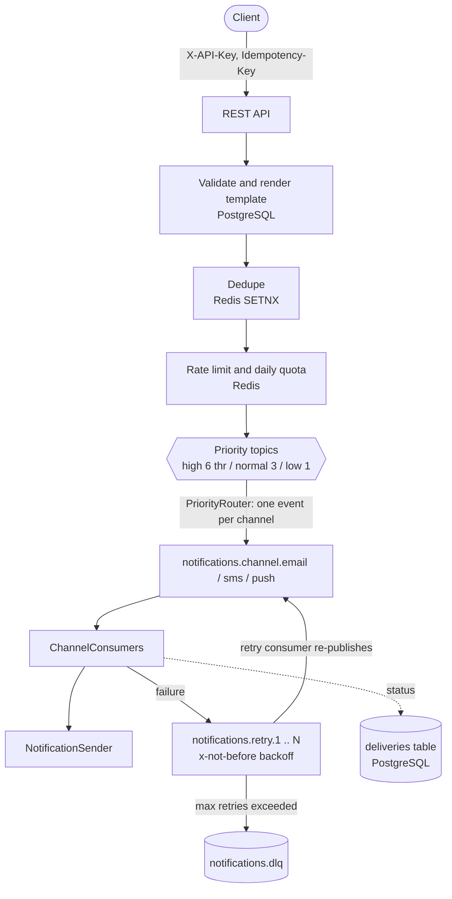

# Multi-Tenant Notification Service

[](https://github.com/Ashishk9670/multitenant-notification-service/actions/workflows/ci.yml)
[](https://github.com/Ashishk9670/multitenant-notification-service/actions/workflows/codeql.yml)
[](https://github.com/Ashishk9670/multitenant-notification-service/actions/workflows/trivy.yml)
[](https://github.com/Ashishk9670/multitenant-notification-service/actions/workflows/k8s.yml)


Spring Boot 3 (Java 21, Maven) service that ingests notification requests over REST, validates and
rate-limits them per tenant, and delivers them through Kafka to email / SMS / push channel consumers
with priority-weighted consumption, retries with exponential backoff and a dead-letter topic.

## Architecture



* **Priority**: three topics; partitions and listener threads follow the weights `6:3:1`
  (`notification.consumers.*`), so HIGH traffic is never starved by LOW bulk traffic.
* **Dedupe**: optional `Idempotency-Key` header, stored in Redis with `SET NX EX`, scoped per tenant.
  Replays return 200 with the original id (`duplicate: true`). The key is released if the request is later rejected.
* **Rate limiting**: per-tenant token bucket executed atomically in Redis (Lua); 429 + `Retry-After`.
  Per-tenant overrides under `notification.rate-limit.tenants.<tenant>`.
* **Quotas**: per-tenant daily counter in Redis (UTC), overrides under `notification.quota.tenants.<tenant>`.
* **Retry**: `delay(n) = min(max, initial * multiplier^(n-1)) +/- jitter`; one retry topic per attempt, then DLQ.
* **Templates**: CRUD at `/api/v1/templates`, stored in PostgreSQL (JPA + Flyway); `{{var}}` and `{{var|default}}`.
* **Delivery status**: every delivery is tracked in the `deliveries` table (ACCEPTED, SENT, RETRYING, DEAD).
* **Stub providers (default)**: log-only senders. A recipient containing `fail` always fails; `flaky` fails twice then succeeds.
* **Real providers (opt-in)**: `EMAIL_PROVIDER=smtp|ses`, `SMS_PROVIDER=twilio`, `PUSH_PROVIDER=fcm` plus credentials from env
  (see `notification.provider.*` in `application.yml`). Channels not switched stay on stubs. See [ADR 0003](docs/adr/0003-provider-adapters-behind-config-flags.md).
* **Circuit breakers**: one Resilience4j breaker per channel; state exported as `resilience4j_circuitbreaker_*`. See [ADR 0001](docs/adr/0001-circuit-breaker-per-channel.md).
* **Delivery-receipt webhooks**: `PUT /api/v1/webhook {"url":"https://..."}` (https only, private/loopback/metadata addresses blocked),
  signed with HMAC-SHA256 (`X-Webhook-Signature`, `X-Webhook-Timestamp`), retried with backoff. `GET`/`DELETE` `/api/v1/webhook`,
  `POST /api/v1/webhook/rotate-secret`. See [ADR 0002](docs/adr/0002-signed-ssrf-safe-webhooks.md).
* **Dashboards**: `docker compose --profile monitoring up -d` provisions Grafana (http://localhost:3000) with an overview dashboard and a
  per-tenant dashboard (`Notification Service - Per Tenant`, pick a tenant from the variable).

Contracts: [`asyncapi.yaml`](asyncapi.yaml) (Kafka events) and OpenAPI at `/v3/api-docs` / `/swagger-ui.html`.

## Run

```bash
docker compose up -d --wait        # Kafka, Redis, Postgres
mvn spring-boot:run                # http://localhost:8080  (admin UI at /)
```

Every `/api/v1/**` call needs a tenant API key (`X-API-Key` or `Authorization: Bearer`); the tenant is resolved from the
key server-side. Keys are issued with the operator admin token (`X-Admin-Token`; `dev-admin-token` in docker-compose,
override with `ADMIN_TOKEN`). The key is shown once and only its hash is stored.

```bash
# 1. issue a key for tenant "acme" (operator only)
KEY=$(curl -s -X POST localhost:8080/api/v1/admin/api-keys -H 'X-Admin-Token: dev-admin-token' \
  -H 'Content-Type: application/json' -d '{"tenantId":"acme","name":"demo"}' | jq -r .apiKey)

# 2. use it
curl -X POST localhost:8080/api/v1/templates -H "X-API-Key: $KEY" -H 'Content-Type: application/json' \
  -d '{"name":"welcome","channel":"EMAIL","subject":"Hi {{name}}","body":"Welcome {{name}}!"}'

curl -X POST localhost:8080/api/v1/notifications -H "X-API-Key: $KEY" -H 'Idempotency-Key: order-1' \
  -H 'Content-Type: application/json' \
  -d '{"channels":["EMAIL"],"priority":"HIGH","recipients":{"email":"a@b.com"},"templateName":"welcome","variables":{"name":"Ann"}}'

curl -H "X-API-Key: $KEY" localhost:8080/api/v1/deliveries
```

The admin UI (`/`) manages templates, sends notifications and shows delivery status for the tenant whose API key you paste into the key field.

## Tests

| Layer | Command | Needs |
|---|---|---|
| Unit (JUnit 5, Mockito, MockMvc, WireMock): rate limiter, backoff, rendering, ingest service, consumers/retry/DLQ, controllers, provider adapters, webhooks, circuit breakers | `mvn test` | nothing |
| Property-based (jqwik): token bucket and backoff invariants. Architecture (ArchUnit): layering and coding rules | `mvn test` | nothing |
| Integration + API (Testcontainers Kafka/Redis/Postgres, RestAssured): dedupe, rate limit, quota, retry, DLQ, templates | `mvn verify` | Docker |
| E2E UI (Playwright, `e2e/`) | `make e2e` or `./scripts/e2e.sh` | Docker, Node 20+ |

`*IT` classes are skipped automatically when Docker is unavailable. Coverage (JaCoCo): `target/site/jacoco/index.html`
after `mvn verify`. CI (`.github/workflows/ci.yml`) runs unit, integration and Playwright jobs and uploads the reports.

Note: on JDK 25+ the build passes `-Dnet.bytebuddy.experimental=true` to Mockito's ByteBuddy; JDK 21 is the target.

## Notes / limitations

* The retry consumer blocks until a message is due (simple and ordered; keep `max-delay` below `max.poll.interval.ms`).
* Notification ids are not persisted at ingest time; delivery rows appear once the router consumes the event.
* Authentication: tenant routes use hashed, revocable API keys (`X-API-Key`); `/api/v1/admin/**` (key management) uses the operator `X-Admin-Token`. Missing/invalid credentials return 401, wrong role 403. `notification.security.bootstrap-keys` pre-provisions keys for dev/test only. Terminate TLS in front of the service.
